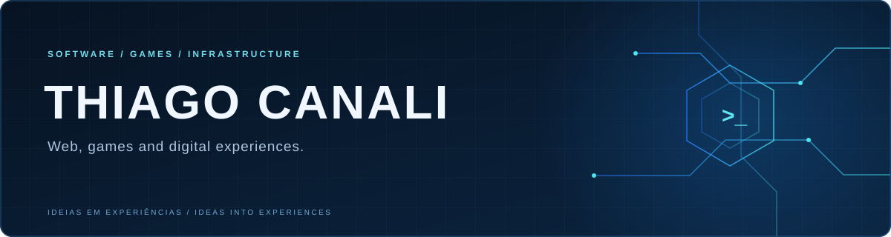

<p align="center">
  
</p>

<p align="center">
  <strong>Desenvolvimento de software · Jogos · Infraestrutura</strong><br />
  <sub>Software development · Games · Infrastructure</sub>
</p>

<p align="center">
  <a href="https://linkedin.com/in/thiagocanali"><strong>LINKEDIN ↗</strong></a>
  &nbsp; / &nbsp;
  <a href="https://jogoperegrino.vercel.app"><strong>JOGAR PEREGRINO · PLAY ↗</strong></a>
  &nbsp; / &nbsp;
  <a href="mailto:thiagocanali@hotmail.com">CONTATO · CONTACT</a>
</p>

## Sobre · About

**Sou Thiago Canali.** Construo aplicações web, jogos e produtos digitais, combinando desenvolvimento de software, experiência em infraestrutura e IA como apoio ao desenvolvimento. Transformo ideias em experiências utilizáveis, com atenção à arquitetura, qualidade e experiência do usuário.

**I'm Thiago Canali.** I build web applications, games and digital products, combining software development, infrastructure experience and AI-assisted development. I turn ideas into usable experiences, with attention to architecture, quality and user experience.

## Projeto principal · Featured project

### Peregrino
**Uma jornada de exploração e descobertas.**  
*A journey of exploration and discovery.*

Aventura narrativa 2D com exploração, personagens, diálogos, missões e reflexões inspiradas em relatos bíblicos. No primeiro capítulo, **A Busca**, Elias chega à Vila da Figueira e encontra histórias que se conectam.

*A 2D narrative adventure with exploration, characters, dialogue, quests and reflections inspired by biblical accounts. In the first chapter, **A Busca**, Elias arrives in Vila da Figueira and discovers interconnected stories.*

| Tecnologia · Technology | Sistemas · Systems | Estado · Status |
| :--- | :--- | :--- |
| Godot 4 · GDScript · Web | Arquitetura modular, diálogos, estados, missões e salvamento / Modular architecture, dialogue, states, quests and saves | Em desenvolvimento · In development |

**[Jogar no navegador · Play in your browser ↗](https://jogoperegrino.vercel.app)**

<sub>Código-fonte privado nesta fase. · Source code is private at this stage.</sub>

## Outros projetos · More projects

| Projeto · Project | Proposta · Purpose | Tecnologias · Technologies |
| :--- | :--- | :--- |
| **[Me Aprovaê](https://github.com/thiagocanali/MeAprovae)** | Estudos para concursos: questões, revisão e desempenho. / Exam preparation: questions, review and performance. | Nuxt · Vue · TypeScript · PostgreSQL |
| **[taskDesk](https://github.com/thiagocanali/taskDesk)** | Tarefas com prioridades, histórico e acesso por usuário. / Tasks with priorities, history and per-user access. | Vue · TypeScript · Node.js · Express · Prisma |
| **[AcolheMente](https://github.com/thiagocanali/AcolheMente)** | Aproximar pessoas e profissionais de Psicologia. / Connecting people and psychology professionals. | Vue · TypeScript · Vite |

<details>
<summary>Estágio dos projetos · Project status</summary>

- **Me Aprovaê:** núcleo de estudos em validação; conteúdo e fluxos em revisão. / Study core under validation; content and flows under review.
- **taskDesk:** CRUD e autenticação implementados; ativação hospedada e integrações de e-mail pendentes. / CRUD and authentication implemented; hosted activation and email integrations pending.
- **AcolheMente:** página institucional implementada; fluxo administrativo em preparação. / Institutional page implemented; administrative flow in preparation.

</details>

## Tecnologias · Technologies

| Área · Area | Ferramentas presentes nos projetos · Tools used across projects |
| :--- | :--- |
| **Interfaces · Front-end** | TypeScript · Vue · Nuxt · React · Next.js · Vite |
| **APIs e dados · APIs & data** | Node.js · Express · PostgreSQL · Prisma |
| **Jogos · Games** | Godot 4 · GDScript · Exportação Web / Web export |
| **Qualidade · Quality** | Documentação · Testes · Revisão de mudanças / Documentation · Testing · Change review |

<sub>As tecnologias variam por projeto; as etapas de implementação estão nos respectivos READMEs. · Technologies vary by project; implementation stages are documented in each README.</sub>

---

<div align="center">
  <h2>THIAGO AI</h2>
  <p><code>COMING SOON</code></p>
  <p><sub>Uma próxima página desta jornada.<br />The next page of this journey.</sub></p>
  <p><sub>Apresentação visual de uma ideia futura. Nenhuma funcionalidade disponível.<br />Visual presentation of a future idea. No functionality available.</sub></p>
</div>

---

<details>
<summary>Documentação técnica deste repositório — Personal Digital Hub</summary>

# Thiago Canali — Personal Digital Hub

Plataforma pessoal para reunir identidade profissional, projetos, experimentos técnicos, publicações e contato.

## Estado atual

**Base executável validada; Fase 3 em andamento.**

A aplicação agora possui um scaffold Next.js com TypeScript, Tailwind CSS, shadcn/ui preparado, Lucide, Geist e páginas públicas estruturais. A leitura editorial e o schema foram implementados e testados localmente. A ativação hospedada do Supabase está bloqueada pelo limite de projetos gratuitos. Autenticação e Control Center seguem pendentes.

## Stack

- Next.js 16.x + React
- TypeScript strict
- App Router com `src/`
- Tailwind CSS 4.x
- shadcn/ui + Lucide
- Geist Sans + Geist Mono
- Supabase PostgreSQL/Auth em fase posterior
- Vercel para Preview e produção

## Scripts

```text
npm run dev
npm run build
npm run start
npm run lint
npm run typecheck
npm test
npm run test:db
npm run test:http
```

Use Node.js 24 LTS (mínimo 22 por requisito do SDK Supabase) e `npm ci` para instalar as versões do `package-lock.json`.

A navegação é compartilhada entre todas as páginas, com indicação de página atual e acesso por teclado. Contato oferece email, LinkedIn e GitHub; não há formulário nem coleta de mensagens. Projetos, Lab e Journal consultam conteúdo publicado no servidor quando o Supabase estiver configurado, com listagens e detalhes por slug. Sem configuração exibem estados vazios; falhas do serviço têm mensagem própria.

O workflow `Quality` executa instalação limpa, lint, tipos, testes de consultas/política SEO, build, smoke HTTP e testes de banco em pull requests e na branch principal. TypeScript 6.0.3 e ESLint 9.39.5 foram escolhidos por compatibilidade com o parser e plugins do Next.js 16.4.6. O npm sinaliza fim de suporte do ESLint 9; acompanhar atualização dos plugins antes de migrar para ESLint 10.

## Documentação

- [Visão do produto](docs/PROJECT.md)
- [Arquitetura](docs/ARCHITECTURE.md)
- [Sistema visual](docs/DESIGN_SYSTEM.md)
- [Roadmap](docs/ROADMAP.md)
- [Dados](docs/DATABASE.md) e [segurança](docs/SECURITY.md)
- [Deploy](docs/DEPLOYMENT.md), [changelog](docs/CHANGELOG.md) e [backlog](docs/BACKLOG.md)
- [Instruções para agentes](AGENTS.md)
- [Prompts por fase](prompts/)

## Perfil público legado

O README anterior continha links públicos, tecnologias e a presença legada `thiagocanali.github.io`. Esses dados foram preservados na documentação inicial, mas não devem ser tratados como validação automática da experiência atual. Conteúdo profissional do novo site precisa ser confirmado antes de publicação.

Links públicos preservados:
- Portfolio legado: https://thiagocanali.github.io/
- GitHub: https://github.com/thiagocanali
- LinkedIn: https://www.linkedin.com/in/thiagocanali
- Email: thiagocanali@hotmail.com
- YouTube: https://www.youtube.com/@thiago.canali

Tecnologias listadas historicamente: Java, JavaScript, TypeScript, Python, PHP; Vue, Angular, React; Flutter, Ionic; Node.js, Firebase; PostgreSQL, MySQL, MongoDB; Git, Linux e VS Code.

## Conteúdo editorial

Leia [DATABASE.md](docs/DATABASE.md) antes de configurar a persistência. `SUPABASE_URL` e `SUPABASE_PUBLISHABLE_KEY` são usadas somente no servidor. Deixe ambas ausentes para desenvolver sem banco; valores ilustrativos de `.env.example` não conectam a um projeto real. Nunca forneça service-role ou secret key ao leitor público.

`npm test` valida consultas e falhas com transporte simulado; `npm run test:db` valida schema/RLS em PostgreSQL 17 descartável via Docker. CI executa ambos. Auth e operações administrativas ainda não existem.

## SEO e preparo público

Canonical e compartilhamento usam o domínio público verificado. Indexação só é habilitada em VERCEL_ENV=production; Preview/desenvolvimento ficam noindex e sem URLs no sitemap. A imagem de compartilhamento é gerada em `/opengraph-image` e o ícone em `/icon.svg`.

`npm run test:http` exige um build feito com `VERCEL_ENV=production` e verifica o servidor real numa porta temporária. Não conecta ao Supabase. Os detalhes de segurança, ambientes e limites estão em SECURITY.md, DEPLOYMENT.md e QUALITY.md.

</details>

<p align="center">
  <sub>THIAGO CANALI &nbsp; / &nbsp; SOFTWARE · GAMES · DIGITAL EXPERIENCES</sub><br />
  <a href="https://linkedin.com/in/thiagocanali"><strong>Vamos conversar · Let's connect ↗</strong></a>
</p>
